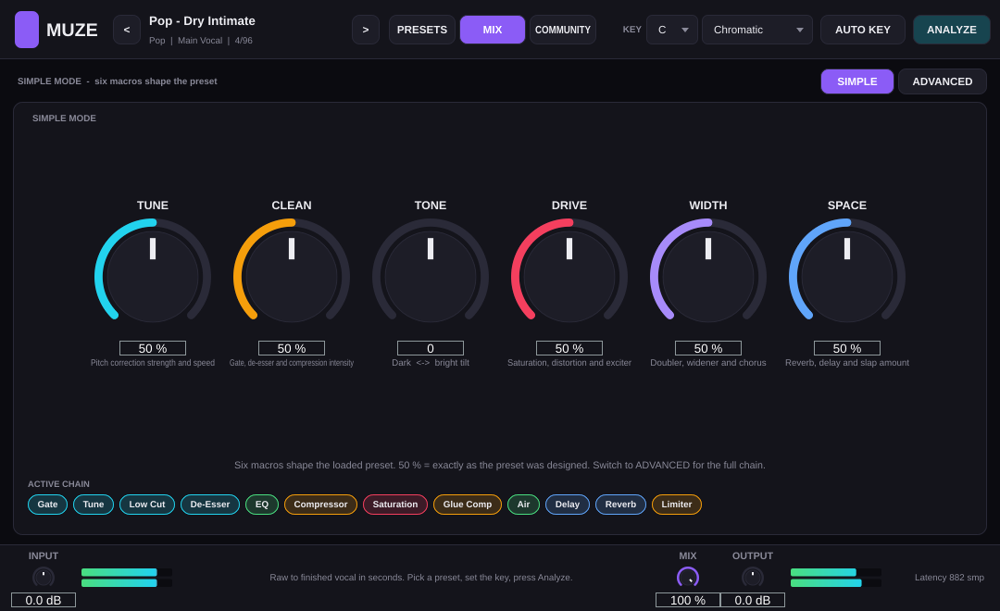
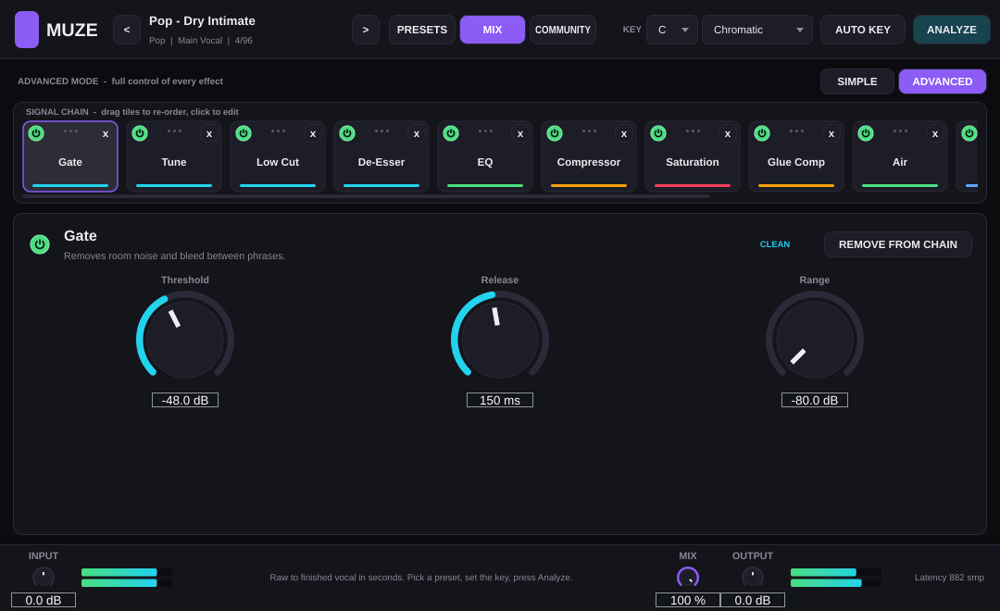
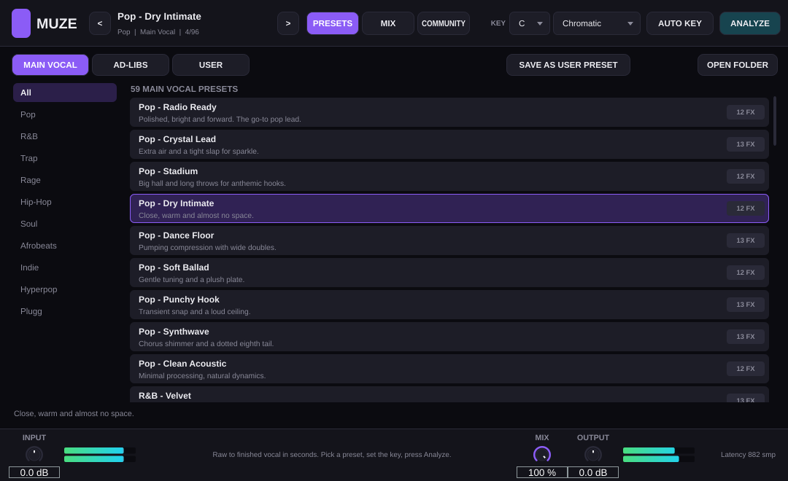
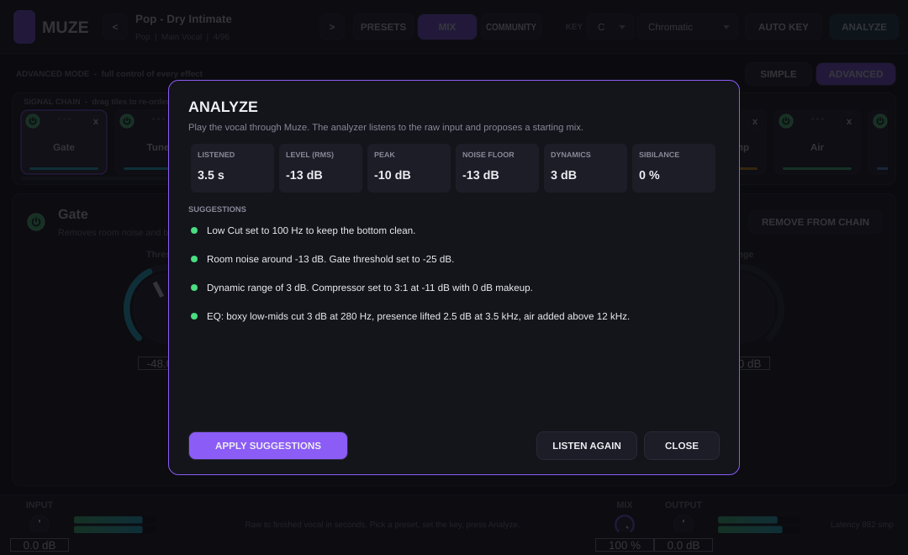
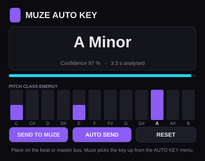

# Muze (open-source replica)

A from-scratch, open-source re-creation of the **Muze** vocal plugin ([muze.fyi](https://www.muze.fyi)):
one plugin that takes a raw vocal to a finished mix in seconds, plus the free **Muze Auto Key** companion.

Built with [JUCE 8](https://juce.com). Ships as **VST3**, **AU** (macOS) and **Standalone**; **AAX** builds when
you point CMake at an AAX SDK.

> This project is an independent clone for learning and personal use. It is not affiliated with, endorsed by or
> derived from the code of muze.fyi. Preset names are genre/style descriptions, not artist names.

## Screenshots

| Simple mode | Advanced mode (chain editor) |
| --- | --- |
|  |  |

| Preset browser | Analyze | Muze Auto Key |
| --- | --- | --- |
|  |  |  |

## Features

| Muze feature | This replica |
| --- | --- |
| 70+ artist-inspired presets (59 main vocal + 37 ad-lib) | 96 factory presets, grouped by genre: Pop, R&B, Trap, Rage, Hip-Hop, Soul, Afrobeats, Indie, Hyperpop, Plugg |
| 27 vocal effects in one plugin, add/remove/drag to re-order | 27 modules (below), free ordering, per-module bypass, drag-and-drop chain strip |
| Simple and Advanced mode | Simple = 6 macros (Tune, Clean, Tone, Drive, Width, Space) that bend the preset without editing it. Advanced = full chain editor with every parameter |
| Auto Key | Chroma/Krumhansl key finder inside Muze (detect from the vocal) **and** the separate *Muze Auto Key* plugin for the instrumental/master bus, linked to Muze through a tiny shared file |
| Analyze: auto mix suggestions | Listens to the raw vocal (level, noise floor, dynamics, mud, presence, sibilance, air) and proposes Low Cut, Gate, De-Esser, Compressor and EQ settings you can apply in one click |
| Community tab: presets shared by other users | Local community library (`Documents/Muze/Community/*.muzepreset`): share, import, load. No online backend |
| Key display | Key + scale selectors in the header (9 scales incl. chromatic, pentatonic, blues) |

### The 27 modules

| Clean | Dynamics | Tone | Color | Modulation | Space |
| --- | --- | --- | --- | --- | --- |
| Gate | Compressor | EQ (4-band) | Saturation | Doubler | Slap |
| Tune (pitch correction) | Glue Comp | Air | Distortion | Harmonizer | Delay (tempo-synced, ducking) |
| Low Cut | Limiter | | Exciter | Chorus | Reverb (pre-delay, ducking) |
| High Cut | Transient | | Lo-Fi | Flanger | |
| De-Esser | | | Telephone | Phaser | |
| | | | | Tremolo | |
| | | | | Auto-Pan | |
| | | | | Widener | |

**Tune** is a real-time monophonic pitch corrector (YIN detection + period-synchronous dual-tap shifter) with
Amount, Speed and Humanize, snapping to the selected key/scale. Latency is reported to the host only while Tune is active.

## Building

Requirements: CMake 3.22+, a C++17 compiler, git. Linux additionally needs the usual JUCE packages
(`libasound2-dev libx11-dev libxrandr-dev libxinerama-dev libxcursor-dev libxext-dev libfreetype-dev libfontconfig1-dev libcurl4-openssl-dev libgl1-mesa-dev`).

```bash
git clone https://github.com/anymeansai/Muze-vst.git
cd Muze-vst
cmake -B build -DCMAKE_BUILD_TYPE=Release      # downloads JUCE 8.0.15 automatically
cmake --build build --config Release -j
```

Outputs land in `build/Muze_artefacts/Release/` and `build/MuzeAutoKey_artefacts/Release/`
(`VST3/Muze.vst3`, `Standalone/Muze`, and `AU/Muze.component` on macOS).
Add `-DMUZE_COPY_PLUGINS=ON` to install into your user plugin folders after each build.

Options:

| CMake option | Default | Purpose |
| --- | --- | --- |
| `JUCE_PATH` | *(download)* | Use a local JUCE checkout |
| `MUZE_BUILD_AUTOKEY` | ON | Build the Muze Auto Key companion |
| `MUZE_BUILD_TESTS` | ON | Build `MuzeTests` (offline DSP / preset tests, `ctest`) |
| `MUZE_BUILD_SCREENSHOT` | OFF | Build the headless editor screenshot tool |
| `MUZE_AAX_SDK_PATH` | *(empty)* | Enable the AAX format |
| `MUZE_COPY_PLUGINS` | OFF | Copy plugins to the user plugin directories |

Run the tests with `./build/MuzeTests_artefacts/Release/MuzeTests` or `ctest --test-dir build`.

## Using it

1. Put **Muze** on the vocal track. Pick a preset (PRESETS tab: Main Vocal / Ad-libs / User).
2. Set the key: choose it in the header, or press **AUTO KEY** to pull it from *Muze Auto Key* (placed on the beat),
   detect it from the vocal itself, or link it so it follows Auto Key automatically.
3. Press **ANALYZE**, play the vocal, and apply the suggested gate/EQ/compression starting point.
4. **SIMPLE** mode: turn the six macros. **ADVANCED** mode: click a tile in the chain to edit its parameters, drag tiles to re-order, `+ ADD` any of the 27 effects, `x` to remove.
5. Save your own chains as user presets, or **SHARE** them to the community folder as `.muzepreset` files.

## Project layout

```
Source/Core        module registry (27 specs), scales, key detector, vocal analyzer, shared-key bridge
Source/DSP         pitch detector (YIN), pitch shifter, filters/utilities, Modules/ (all 27 effects)
Source/Presets     preset model + generated factory data (tools/gen_presets.py)
Source/Plugin      MuzeProcessor (APVTS, chain engine, presets, state) and the editor UI
Source/AutoKey     Muze Auto Key processor + editor
Tests              offline test runner and headless screenshot tool
```

## License

Source code in this repository is released under the **GNU AGPLv3**, matching the JUCE 8 open-source license.
JUCE itself is (c) Raw Material Software and is downloaded at configure time under its own license.
