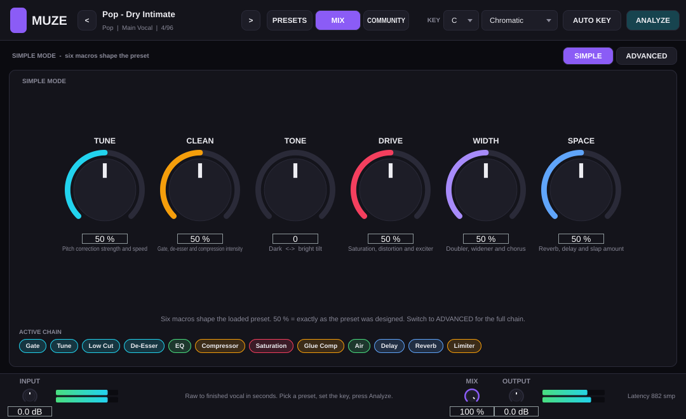
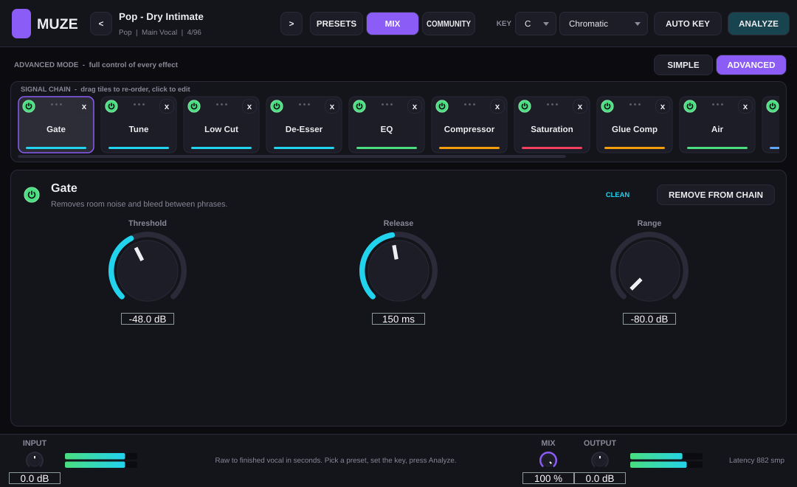
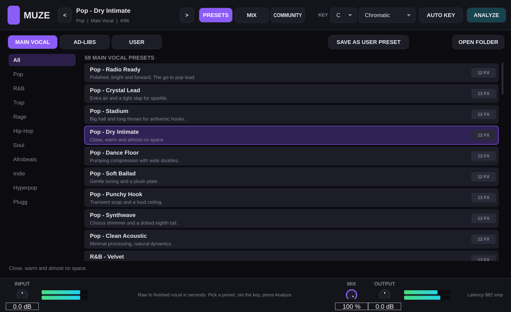

# Vocalyst

**Vocalyst** is an open-source vocal plugin: one plugin that takes a raw vocal to a finished mix in seconds, plus the
free **Vocalyst Auto Key** companion that finds the song key for you.

Built with [JUCE 8](https://juce.com). Ships as **VST3**, **AU** (macOS) and **Standalone**; **AAX** builds when
you point CMake at an AAX SDK.

## Screenshots

| Simple mode | Advanced mode (chain editor) |
| --- | --- |
|  |  |

| Preset browser | Analyze | Vocalyst Auto Key |
| --- | --- | --- |
|  |  |  |

## Features

- **96 presets**: 59 main-vocal and 37 ad-lib chains grouped by genre (Pop, R&B, Trap, Rage, Hip-Hop, Soul, Afrobeats, Indie, Hyperpop, Plugg). Every preset is a full effect chain you can open and edit.
- **27 vocal effects in one plugin**: add, remove and drag effects into any order, with per-module bypass.
- **Simple and Advanced mode**: Simple gives six macros (Tune, Clean, Tone, Drive, Width, Space) that bend the loaded preset without editing it. Advanced exposes every parameter of every effect.
- **Tune**: real-time monophonic pitch correction (YIN detection + period-synchronous shifter) with Amount, Speed and Humanize, snapping to the selected key and scale. Latency is reported to the host only while Tune is active.
- **Auto Key**: a chroma-based key finder inside Vocalyst (detect from the vocal itself) **and** the separate *Vocalyst Auto Key* plugin for the instrumental or master bus, linked to Vocalyst through a small shared file so the key follows automatically.
- **Analyze**: listens to the raw vocal (level, noise floor, dynamics, mud, presence, sibilance, air) and proposes Low Cut, Gate, De-Esser, Compressor and EQ settings you can apply in one click.
- **Community tab**: a local shared-preset library (`Documents/Vocalyst/Community/*.vocalystpreset`) to share, import and load chains from other users. No online account needed.
- **Key display**: key and scale selectors in the header, with 9 scales including chromatic, pentatonic and blues.

### The 27 modules

| Clean | Dynamics | Tone | Color | Modulation | Space |
| --- | --- | --- | --- | --- | --- |
| Gate | Compressor | EQ (4-band) | Saturation | Doubler | Slap |
| Tune (pitch correction) | Glue Comp | Air | Distortion | Harmonizer | Delay (tempo-synced, ducking) |
| Low Cut | Limiter | | Exciter | Chorus | Reverb (pre-delay, ducking) |
| High Cut | Transient | | Lo-Fi | Flanger | |
| De-Esser | | | Telephone | Phaser | |
| | | | | Tremolo | |
| | | | | Auto-Pan | |
| | | | | Widener | |

**Tune** is a real-time monophonic pitch corrector (YIN detection + period-synchronous dual-tap shifter) with
Amount, Speed and Humanize, snapping to the selected key/scale. Latency is reported to the host only while Tune is active.

## Download (macOS, Windows, Linux)

Every push builds all three platforms on GitHub Actions. Open the **Actions** tab of this repository, pick the latest
green run, and download `Vocalyst-macOS` (universal VST3 + AU + Standalone), `Vocalyst-Windows` or `Vocalyst-Linux` from
*Artifacts*. Tagging a commit `v1.0.0` publishes the same zips on the **Releases** page.

macOS users: the bundles are ad-hoc signed, not notarized, so follow [docs/INSTALL-macOS.md](docs/INSTALL-macOS.md)
(copy to `~/Library/Audio/Plug-Ins/VST3`, clear the quarantine flag with `xattr`, rescan).

## Building

Requirements: CMake 3.22+, a C++17 compiler, git. Linux additionally needs the usual JUCE packages
(`libasound2-dev libx11-dev libxrandr-dev libxinerama-dev libxcursor-dev libxext-dev libfreetype-dev libfontconfig1-dev libcurl4-openssl-dev libgl1-mesa-dev`).

```bash
git clone https://github.com/anymeansai/Muze-vst.git
cd Muze-vst
cmake -B build -DCMAKE_BUILD_TYPE=Release      # downloads JUCE 8.0.15 automatically
cmake --build build --config Release -j
```

Outputs land in `build/Vocalyst_artefacts/Release/` and `build/VocalystAutoKey_artefacts/Release/`
(`VST3/Vocalyst.vst3`, `Standalone/Vocalyst`, and `AU/Vocalyst.component` on macOS).
Add `-DVOCALYST_COPY_PLUGINS=ON` to install into your user plugin folders after each build.

Options:

| CMake option | Default | Purpose |
| --- | --- | --- |
| `JUCE_PATH` | *(download)* | Use a local JUCE checkout |
| `VOCALYST_BUILD_AUTOKEY` | ON | Build the Vocalyst Auto Key companion |
| `VOCALYST_BUILD_TESTS` | ON | Build `VocalystTests` (offline DSP / preset tests, `ctest`) |
| `VOCALYST_BUILD_SCREENSHOT` | OFF | Build the headless editor screenshot tool |
| `VOCALYST_AAX_SDK_PATH` | *(empty)* | Enable the AAX format |
| `VOCALYST_COPY_PLUGINS` | OFF | Copy plugins to the user plugin directories |

Run the tests with `./build/VocalystTests_artefacts/Release/VocalystTests` or `ctest --test-dir build`.

## Using it

1. Put **Vocalyst** on the vocal track. Pick a preset (PRESETS tab: Main Vocal / Ad-libs / User).
2. Set the key: choose it in the header, or press **AUTO KEY** to pull it from *Vocalyst Auto Key* (placed on the beat),
   detect it from the vocal itself, or link it so it follows Auto Key automatically.
3. Press **ANALYZE**, play the vocal, and apply the suggested gate/EQ/compression starting point.
4. **SIMPLE** mode: turn the six macros. **ADVANCED** mode: click a tile in the chain to edit its parameters, drag tiles to re-order, `+ ADD` any of the 27 effects, `x` to remove.
5. Save your own chains as user presets, or **SHARE** them to the community folder as `.vocalystpreset` files.

## Project layout

```
Source/Core        module registry (27 specs), scales, key detector, vocal analyzer, shared-key bridge
Source/DSP         pitch detector (YIN), pitch shifter, filters/utilities, Modules/ (all 27 effects)
Source/Presets     preset model + generated factory data (tools/gen_presets.py)
Source/Plugin      VocalystProcessor (APVTS, chain engine, presets, state) and the editor UI
Source/AutoKey     Vocalyst Auto Key processor + editor
Tests              offline test runner and headless screenshot tool
```

## License

Source code in this repository is released under the **GNU AGPLv3**, matching the JUCE 8 open-source license.
JUCE itself is (c) Raw Material Software and is downloaded at configure time under its own license.
